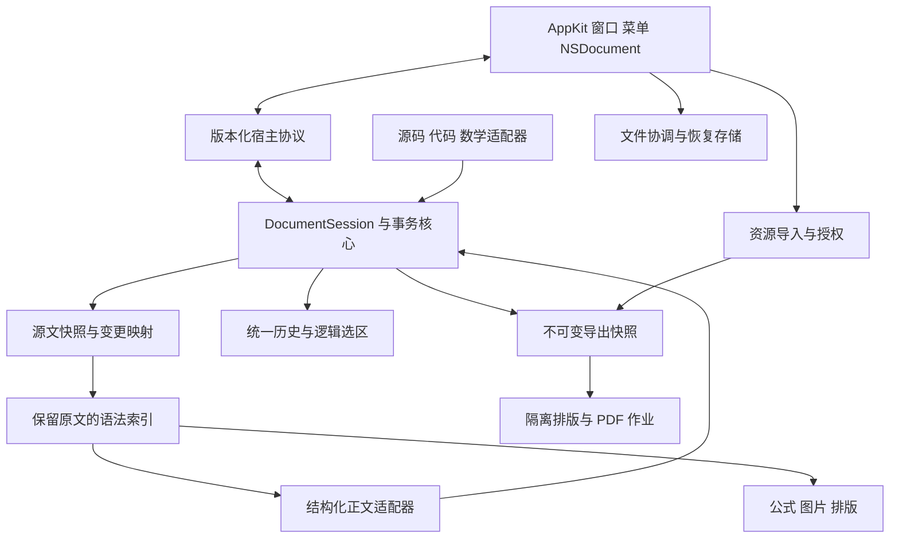
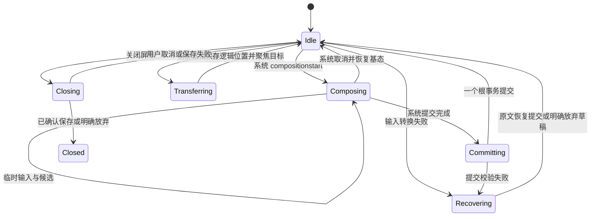

# 从零重写技术方案

日期：2026-10-21。状态：用户已批准开始实现；选型与质量门槛仍须由原型和验收证明。对应[需求分析](../specs/requirements.md)与[编辑行为契约](../specs/editing-contracts.md)。本文不把旧项目的修补方案、依赖或测试结果带入新基线；执行进度见[实施计划](../superpowers/plans/2026-10-21-initial-rewrite.md)。

## 1 设计结论

推荐重新开发 macOS 文稿宿主，并优先验证“**结构化正文编辑器 + 保留源文的文档核心 + 专用字面文本编辑器**”。正文候选为 ProseMirror，源码及代码/数学源码候选为 CodeMirror 6；它们都通过文档事务适配器提交修改，不各自决定磁盘内容和撤销历史。

这个推荐来自两个独立约束：Typora 的结构、编辑归属、选区与历史紧密关联；本产品又要求普通 Markdown 的局部保真。Typora 的节点序列化会改写部分输入，不能直接采用其读写模型。旧版全文 CodeMirror 投影不作为默认路径，结构化路线也必须先通过保真与输入法原型，不能直接进入完整功能开发。

## 2 候选路线与取舍

| 路线 | 机制 | 主要优势 | 必须承担的风险 | 结论 |
| --- | --- | --- | --- | --- |
| A 全文源码编辑器投影 | 一个源码编辑器隐藏标记、替换复杂块 | 文本与源码位置直接，保真容易表达 | 连续结构选择、富表格、嵌套块、视觉/源码坐标和 IME 交错复杂 | 保留为比较原型，不能因旧代码已有实现就优先 |
| B 结构编辑加无损源文核心 | 结构化正文视图发送编辑意图，核心生成源文局部变更 | 操作以段落/列表/表格结构表达；可复用成熟正文输入机制 | 结构树与源文映射、局部序列化、IME 和统一历史是高风险适配工作 | 推荐先验证 |
| C 原生 TextKit 正文 | 原生文本系统配合附件和自研结构编辑 | 原生输入、无障碍、系统事件集成有利 | Markdown 结构、公式/表格、跨附件选区与打印需要大量定制 | 作为 B 失败后的独立重评方向 |

Electron 属于宿主选择，不是上述编辑模型的替代。当前仅面向 macOS，优先 AppKit + WKWebView；跨平台不是首版收益，不为此引入新的桌面运行时。这个选择与 Typora 的静态宿主证据相容，但并非“Typora 这样做所以必然正确”。

ProseMirror 提供 schema、状态、选区和事务机制，但具体 Enter 等命令仍由应用决定。CodeMirror 提供文本状态与事务视图；它们都不自动满足无损 Markdown 或跨组件统一历史。[ProseMirror Guide](https://prosemirror.net/docs/guide/)、[CodeMirror System Guide](https://codemirror.net/docs/guide/)

## 3 系统边界



建议最终目录按职责建立 `native/`、`editor/core/`、`editor/syntax/`、`editor/surfaces/`、`editor/render/`、`editor/protocol/`、`fixtures/`、`tests/`。这些目录此时不搭脚手架，先用原型确认数据结构，再建立正式实现。旧 `Sources/` 和 `web/` 不复制迁移。

| 模块 | 所有权 | 明确不承担 |
| --- | --- | --- |
| DocumentSession | committed revision、源文快照、逻辑选区、活动 owner、事务入口 | 不直接访问磁盘或原生菜单 |
| SyntaxIndex | 版本化语法树、原文 token、引用依赖、位置映射 | 不维护可独立编辑的第二份正文 |
| SurfaceAdapter | 接收输入，形成意图/补丁，维护活动输入视图 | 不直接保存、不私自重排源文、不独立提交根历史 |
| History | 根事务、逆补丁、前后选区、分组边界 | 不保存 DOM 节点引用 |
| NativeDocument | 文件身份、已确认快照、保存和恢复协调 | 不从渲染 DOM 抓文本，不独立执行编辑命令 |
| AssetService | 资产身份、暂存、复制、授权、持久化清单 | 不修改正文；仅返回可提交的引用结果 |
| ExportJob | 固定内容/资源/样式版本的输出 | 不切换活动编辑模式，不复用可变编辑 DOM |

## 4 文档模型与唯一提交入口

### 4.1 权威状态

根文档持有保留原始换行的 UTF-16 文本缓冲区、编码元信息和递增 revision。语法树、富文本树、布局和 DOM 均由该版本派生。源文作为持久化权威是依据保真需求重新作出的选择，独立于全文是否使用 CodeMirror 显示。

无损语法索引必须覆盖全部字符，包含分隔符、空白间隙、前缀、未知块及错误片段。AST 只表示语义，不足以做无损保存。节点携带稳定 ID、来源范围和局部风格；只有未受影响节点可复用 ID，拆分/合并必须生成显式映射。

字符串偏移统一为 UTF-16 半开区间；字节写入用明确 UTF-8 编码与 BOM 元信息；用户字符导航以 grapheme 为界。LF/CRLF 均保存在原文中；展示适配器如需统一行尾，必须带双向位置映射。新插入换行优先采用当前块的样式，无上下文时取文档主导样式，再回退 LF。

建议公开类型（协议草案，不是现有代码）：

```ts
type Owner =
  | { kind: "prose" }
  | { kind: "source" }
  | { kind: "code" | "math"; nodeId: string }
  | { kind: "cell"; tableId: string; row: number; column: number };

type Anchor = { offset: number; affinity: "before" | "after" };
type LogicalSelection = {
  anchor: Anchor; head: Anchor; owner: Owner;
  kind: "text" | "node" | "cells";
  cellRange?: { fromRow: number; fromColumn: number; toRow: number; toColumn: number };
};
type Patch = { from: number; to: number; insert: string };
type EditIntent = {
  documentId: string; epoch: string; baseRevision: number;
  commandId: string; owner: Owner; selection: LogicalSelection;
  payload: unknown; historyGroup: string;
};
```

`payload` 在协议边界必须由具体 command schema 验证，不能接受任意对象。节点选择和单元格范围保留其语义形状，同时持有可恢复的源文锚点。

### 4.2 提交链路

1. 适配器将输入转为 intent，携带 baseRevision、owner 与前选区。
2. 核心在该版本的结构上下文中解释命令，生成互不重叠、基于旧版本坐标的补丁及允许变更范围。
3. 校验边界、字素/代理对安全、语法归属、资源前提和目标结构；拒绝跨 epoch 或过期的命令，不直接把旧 offset 套在新文档。
4. 一次性应用补丁，生成新 revision、逆补丁、selection mapping 和 dirty 状态；向历史提交一个原子单元。
5. 增量更新语法与相关呈现，映射 owner/选区；发布不可变 checkpoint 给宿主。

普通文本插入不必等待整篇复杂解析。结构上下文未就绪时，对所在容器同步校验；不能安全解释则暂留原文编辑状态，不猜测列表或表格结构。后台解析结果必须同时匹配 revision、节点身份与内容哈希才可采用。

### 4.3 结构化视图适配

ProseMirror schema 包含段落、标题、列表、引用、表格、代码/数学节点、图片、原始块和保留空白的 gap 表示。未知语法不能在导入时被 schema 丢掉。gap 中每个可编辑空位置都有独立源文 offset，affinity 只区分边界两侧，不用于给多个空段落复用同一个坐标。

以下为 LF、零起始 UTF-16 的投影 oracle；CRLF 按两个代码单元计算，不能把行号直接当 offset：

| 原文 | 实时可编辑位置 | 反向映射 |
| --- | --- | --- |
| `A\n\nB` | A、B 两段，无额外空段落 | A 尾 1，B 首 3 |
| `A\n\n\nB` | A、一个空位置、B | A 尾 1，空位置 3，B 首 4 |
| `A\n\n\n\nB` | A、两个空位置、B | 空位置分别 3、4；B 首 5 |
| `A\n` | A，单个结尾换行不生成空段落 | A 尾 1；EOF 源码锚点 2 保留但不额外展示空段 |
| `A\n\n` / `A\n\n\n` | A 后分别一/两个空位置 | 分别为 3 / 3、4，其中最后一个为 EOF |
| `A\n \n\nB` | A、一个空位置、B，间隔中的空格保持 | 空位置 4、B 首 5；空格属于原 gap token |
| 空字符串 | 一个可输入位置 | offset 0 |
| 全空白文档 | 按物理空白行呈现可编辑位置 | 各行开头及末尾空行对应真实 offset；空白不规范化 |

两个非空块间至少两个行结束符建立段落间隔，其余每个形成一个额外空位置；非空末段后的两个行结束符已形成一个尾部空段。空段 Enter 增加一个行结束符，非空段拆分插入两个。前导空白逐物理行保留输入位置；含空格行的文字输入不隐式删除原空格。

源文模式中位于隐藏分隔符的锚点，在实时模式暂显示到 affinity 所指的相邻位置，但根逻辑锚点保留原 offset；没有实际用户移动/编辑时，切回源码恢复原 offset。用户一旦移动或输入，则按当前可见位置形成新的逻辑选择。此规则防止多对一显示映射破坏 E05 的无编辑往返。

ProseMirror 事务仅是输入建议。普通插入、删除和 mark 操作先按来源映射生成局部补丁；结构命令由项目命令层明确生成目标树和最小合法改写范围。不可把每次富文本交易转成“整篇 Markdown stringify”。

对任意第三方 Step 的无损转换并非免费能力。首版只接受已注册、已验证的 Step/命令类型；插件不得绕过入口。无法转换的输入进入 `RecoveryDraft`，记录 baseRevision、来源范围、可见文本差异和原始输入；尝试转换为原始块补丁，如仍有歧义则冻结该输入表面并提供源码恢复入口，不能丢弃草稿或显示保存成功。

RecoveryDraft 与根源文分开持久化为应用恢复记录，不伪装成已保存 Markdown。手动保存、关闭、模式切换和 Undo 必须先恢复为合法根事务，或由用户明确放弃该草稿；不能直接用最后 committed checkpoint 覆盖可见输入。自动保存可保存 committed 文稿，同时持久化故障草稿。此恢复路径纳入 G1。

### 4.4 局部序列化

保留未改变 token 的原文。普通字符修改只改内容 token；改变 mark 只改相关分隔符；拆分段落改写对应段落和间隔；列表移动改写受影响父容器内的前缀和必要分隔；表格结构变化改写该表格。serializer 必须返回 `patches + changedRanges + sourceMap`，不只返回字符串。

示例：对 `**bold**` 中的 `ol` 删除，结果为 `**bd**`；完整 strong 的 Cut 则移除整组星号及文字。两者用逻辑选择规则区别，不靠序列化时自动清理。

解析器候选优先考察 micromark 的 token/event 信息与独立的语义适配；其官方实现将输入转为 token 事件，但这不自动提供项目所需的可编辑、增量、无损树。须自行验证 gap、转义、未闭合结构及 Unicode 范围覆盖。[micromark](https://github.com/micromark/micromark)

## 5 编辑生命周期

### 5.1 编辑归属和输入法

同一时刻仅一个 owner 接收内容输入。菜单、键盘、上下文菜单共用命令注册表，按 owner 与 composition 状态计算可用性。代码和数学作为字面内容域，普通 Markdown 结构命令不进入这些域。



组合输入期间保留活动 DOM 与适配器临时状态，不将每个预编辑字符写入根历史；提交时一次性形成事务。渲染、模式切换、外部文件重载和结构命令排队。真实 compositionend 与最后 input 的不同顺序必须通过 macOS 原生观测确定稳定提交点，不能用固定毫秒延时当完成协议。

普通已提交输入每次进入根状态。允许的临时内容分叉只有系统 composition 草稿和显式故障态 RecoveryDraft，二者不能被当作已提交文稿。原型必须证明组件自身的 composition 事务能够被此适配策略承接，避免框架与应用争夺 DOM。

### 5.2 源码、局部编辑器和历史

CodeMirror 仅作为源码/字面输入表面，禁用独立内容历史并把 undo/redo 路由到根 History。源码模式使用可见 LF 规范化映射时，修改必须映射回原 EOL；代码/数学编辑器的局部坐标通过宿主节点 content range 转换。

历史项保存正向/逆向补丁、原文风格元信息及前后逻辑选区，不保存已销毁的 DOM。普通连续输入按同 owner、相邻编辑和显式分组边界合并；选择移动、结构命令、粘贴、模式切换和 IME 提交结束当前分组。

Undo 也产生新 revision；dirty 依据内容与资产状态是否等于已保存 checkpoint，而非简单比较 revision 大小。视图切换只变 presentation，不重建根历史。原生 UndoManager 作为根命令入口，不能再次记录已经进入根 History 的同一操作。

### 5.3 异步呈现

公式、图片和高亮任务使用 `{epoch,nodeId,contentHash,renderGeneration}`。结果只更新仍匹配的非活动视图，过期结果丢弃；composition、拖选和 owner 交接期间不替换活动节点。可见文本、空行和点击区域由同一布局节点定义，不维护一套与文字脱离的透明点击覆盖层。

公式采用渲染器公开 API；优先以 KaTeX 验证需求语料，若功能不足再比较 MathJax。禁止依赖私有 AST/DOM 节点去猜 LaTeX 像素映射。限制宏展开和尺寸，默认禁止受信任 HTML/资源命令，缓存不得跨文档共享可变宏状态。[KaTeX Options](https://katex.org/docs/options)、[KaTeX API](https://katex.org/docs/api)

## 6 原生宿主协议

初版实际封套为 `{v:1, documentId, epoch, requestId, method, payload}`，内容版本位于具体载荷的 `revision` 或 `baseRevision`。Web 通过 `window.webkit.messageHandlers.ret.postMessage` 请求，宿主通过 `window.retNative.receive` 响应。仅可信应用主 frame 可以调用注册方法；载荷 schema、长度、路径授权和生命周期都要验证。首次 `ready` 允许空身份，宿主 `load` 分配会话；之后请求必须匹配文稿与 epoch。

| 能力 | 载荷/结果 | 约束 |
| --- | --- | --- |
| `ready` / `load` | source、savedSource、revision、displayName、fileURL、appearance、可选 recoveryDraft、assetToken | 源文保留 BOM/EOL；savedSource 是真实保存基线；本地 revision 加 load.revision 后用于桥接 |
| `checkpoint` / `checkpointAck` | source、revision、dirty；ACK stage 为 received 或 durable | 宿主先接收，恢复记录落盘后另确认 durable；旧 revision 不覆盖新 checkpoint |
| `recoveryDraft` | draft 的真实内容、baseRevision、owner、format、可选 recoverySource，或 null | 有草稿时阻止普通保存；变更恢复通过 checkpoint.resolvesRecoveryDraft 原子提交；null 只用于明确放弃或无内容变化的恢复 |
| `flush` / `flushResult` | 同一 requestId；ready 携带 source/revision，pending 携带 reason | 组合输入或待恢复草稿不能冒称已提交；宿主屏障超时不构成保存成功 |
| `reloadPrepare` / `reloadReady` | 候选 epoch/load；旧身份下返回 ready 的 source/revision 或 pending | 编辑器同步持有输入屏障后才确认；当前组合输入或 RecoveryDraft 阻止准备 |
| `reloadCommit` / `reloadComplete` / `reloadCancel` | 同一事务 requestId；提交使用候选 epoch，取消使用旧身份 | 候选载荷在准备时冻结；持久化旧内容与资源后才提交；重复提交只重发确认，取消后迟到准备无效 |
| `saved` | 已成功保存的 source、revision | 只确认相同源文基线；N 保存成功不能清除 N+1 的 dirty |
| `collectAssets` / `assetManifest` | 固定 source/revision → paths/revision，沿用 requestId | 清单由相同 Markdown 解析器产生；最多 10000 项、每项 8192 UTF-8 字节；路径清单不授予文件系统访问权限 |
| `importImage` / `assetResult` | 空载荷为选择器，source:'clipboard' 为图片剪贴板，或 dataURL/fileName；返回 relativePath 或 error | 先安装完整资源再返回；响应封套 ID 必须匹配，载荷中的可选 requestId 也须一致；由 web 用保存的选区创建一次根事务 |
| `prepareExport` / `exportContent` | 固定 source/revision → html/revision，沿用 requestId | 原生先冻结资源字节，再异步渲染；替代或失效作业不能提交旧结果；实际渲染失败元素使原生导出失败并保留旧文件 |
| `command` / `commandState` | 已注册 id；enabled 为命令 id 到布尔值的映射 | 原生菜单和网页快捷键读取 `editor/protocol/commands.json`；按 owner、历史、活动事务及缩放状态验证可用性 |
| `openLink` | url | 仅允许 http/https/mailto，由宿主交系统应用；编辑 WebView 不导航 |
| `appearance` / `error` | mode；或 message/operation | 外观不修改源文；错误不会伪装成 saved |

`assetToken` 是原生资源存储分配的能力标识；图片 URL 为 `ret-asset://<assetToken>/<按组件转义的相对路径>`。本地实时解析仍验证原生授权根与符号链接，打印解析只读取该作业冻结的图片字典。百分号转义仅在 Markdown/URL 边界解码一次，归一化后的文件名中的字面 `%20` 不再解释为空格。

请求状态为 pending/completed/cancelled/failed，终态只进入一次。关闭/重载使 epoch 失效；迟到、重复响应不得更新新会话。设有上限的超时可报告失败，但超时不等于证明操作没有发生；保存/资产操作以 operationId 幂等查询结果。

不复制 Typora 的动态 eval handler 或同步 prompt 桥接。外链由宿主验证协议后交系统浏览器；编辑 WebView 拒绝导航到任意网页。Markdown、SVG、样式及图片都不持有桥接调用权限。

正文命令同时检查实际焦点是否属于当前 ProseMirror/CodeMirror 编辑区，不能只使用上次保存的逻辑选区。快捷键捕获、原生命令可用性和最终执行共用此规则；链接、公式、语言、查找与替换输入框保留自身撤销，不修改背后的 Markdown。窗口级命令单独声明，模态对话框打开时暂停所有编辑器命令；原生菜单状态即使迟到，执行时也重新检查焦点。

## 7 保存、恢复和资源事务

### 7.1 保存屏障

AppKit NSDocument 负责系统文稿生命周期。其自动保存能力声明不是某一时刻已经保存的证明，具体操作应使用系统传入的保存类型判断。[Apple autosavesInPlace](https://developer.apple.com/documentation/appkit/nsdocument/autosavesinplace)

保存协调器先取得已提交 snapshot，随后按单文档串行队列执行。宿主持有最新 received checkpoint；文稿同步取数据入口只读取不可变快照，不在阻塞主线程时等待 JavaScript 回调。手动保存、另存、版本恢复、关闭和退出先走异步 flush 屏障，再进入系统保存路径；自动保存可以选用最近提交版本，不能声称覆盖尚在预编辑中的文字。

关闭进入协调器屏障后暂停新提交，等待已经进入不可取消替换阶段的作业完成，再呈现可用的保存/放弃/取消选择及此时的磁盘基线。选择放弃时取消尚未提交的保存/资产作业，失效 operation token，并在同一队列确认不会再有旧作业提交后关闭。已经完成的系统自动保存属于磁盘基线，不能假称被取消；回退它属于显式版本恢复。取消关闭则解除屏障恢复会话。临时文件和 journal 由所属作业按实际提交状态处理，不仅仅丢弃前端响应。

### 7.2 磁盘提交

使用系统文件协调并验证外部文件代数/内容指纹；在授权目标同卷创建临时文稿，完成写入后原子替换，成功后更新已保存 checkpoint。文件协调失败、磁盘满、权限错误、目标被移除均保留 dirty 和恢复副本。

不把“创建了临时文件”视为提交完成，也不声称常规原子替换等价于断电无损。需要保留平台可支持的错误回执和恢复路径，实际耐久性边界在故障注入中记录。

### 7.3 图片和跨文件提交

资产复制与 Markdown 写入不是单文件原子事务，使用独立 journal：

1. 按 operationId 记录导入意图、源授权、目标 asset ID。
2. 暂存、校验内容与类型，最终文件名不可覆盖已有资产。
3. 全部必需资源安装成功后提交 Markdown 引用及文稿文件。
4. 文稿失败时保留 journal 和资源用于重试；多余资源可存在，断裂的已保存引用不可接受。
5. 重试按 operationId/哈希幂等，不重复插入正文。撤销引用不删文件。

首次保存和另存包含“资源准备 → 文稿提交 → 更新身份”的状态机；失败不能把文档身份提前切到新位置。整个作业冻结同一 revision 的正文和资产清单，后续输入保留在旧会话的新 revision，不能混入已冻结的另存作业；成功后基于明确变更映射切换路径与资源根，未保存的新输入仍为 dirty。自行管理的相对引用是否迁移由明确分类和用户选择决定。

未命名文稿的管理资源使用文稿独立的稳定目录名；首次保存及另存复制资源时可保留该相对目录名，不为匹配新文件名改写既有源文与撤销历史。已保存文稿后续新导入图片仍进入 `<当前文档名>.assets/`。因此一份文稿可能引用多个管理资源目录。冻结 N 后新增的 N+1 资源继续从已授权的原暂存区解析，下一次保存提交前完成复制；资源归属与恢复位置须持久化，不能只存于内存。目标同名但内容不同的文件不得被覆盖或冒认为同一资产。

### 7.4 恢复与外部变更

区分宿主内存的 `receivedCheckpoint` 与已成功写入恢复存储的 `durableRecoveryCheckpoint`。恢复记录在文档独立目录存放实际源文字节、hash、编码、资源快照/位置、revision 和可选 RecoveryDraft；先写临时记录并校验，再原子更新当前指针，保留上一份有效记录。恢复时校验内容及资源，损坏则退回上一份并提示缺失，不从 hash 推测正文。

每次收到 checkpoint 可合并排队持久化，目标空闲后 1 s 内落盘；该目标是调度上限而非掉电保证。手动恢复屏障需等待 durable ACK，失败明确可见。WebContent 退出可使用宿主 receivedCheckpoint；整个应用崩溃或系统重启只能恢复 durable 记录。未持久化输入的风险必须按此边界表达。进程退出回调只提供触发点。[Apple WebContent termination](https://developer.apple.com/documentation/webkit/wknavigationdelegate/webviewwebcontentprocessdidterminate(_:))

目标设计中，版本恢复先处理当前输入和未保存更改，冻结当前内容/资源的恢复记录，再读取选定系统版本；验证引用资源是否仍存在，缺失时给出占位与清单。用户接受后以新 epoch 加载版本、重建视图并清空针对旧内容的编辑历史；旧内容通过保留的恢复记录回退，不把旧逆补丁混用到新版本。

初版实现的已存文件恢复与外部重载使用 `reloadPrepare → reloadReady → reloadCommit → reloadComplete`。准备应答前同步暂停新输入，旧身份保留到保护性恢复记录及其独立资源 journal 成功写入。准备超时或取消释放旧会话；提交后重复投递直到匹配完成，不能因确认丢失而退回旧身份。系统历史版本同步回调在此 alpha 明确拒绝，不改变当前源文、文件路径或身份；历史版本导入仍需后续专门实现，已存文件恢复不是它的等价替代。

每次原生重载持有不可变的 `ReloadToken(requestID, candidateEpoch)`，准备回执、恢复持久化回调、超时、取消、提交与重试均验证该精确身份。旧事务的迟到成功或失败回调不得借用新事务的屏障。应用候选前重新比较磁盘内容；外部再次变化则保留原会话并取消本次替换。

外部更改到达时在当前输入完成后比较：只有内容 clean、无 RecoveryDraft、无待持久化引用资源时可自动加载；否则保留本地和外部候选并显示冲突选项。仅读取外部候选不失效本地 epoch；用户接受并完成切换时才失效旧 epoch、保存恢复快照。选择期间外部再次变化须重新验证版本；取消保持原会话。外部重命名更新经确认的文件身份和资源基准；删除则保留内存内容并进入另存路径，不重建已删除文件而无提示。

## 8 渲染、排版与 PDF

结构化正文与导出共享同一方言和排版令牌，导出不读取活动 contenteditable DOM。导出快照冻结内容、资产内容哈希、字体与样式版本；图片即使被外部修改也不改变已开始作业。

独立 WKWebView 加载打印文档；等待字体、图片与公式全部进入成功/明确失败状态，再生成 A4 分页 PDF。初版已选定公开的 WKWebView 打印操作：允许后台打印线程，并通过异步 `runModal` 完成 NSPrintOperation。实际样本已验证 A4、四边 20 mm、中文文本提取及跨页内容；同步运行曾无法取得有限分页范围，因此不作为实现路径。打印作业使用独立隐藏窗口和非模态进度窗口，完成回调明确切回 MainActor。表格续页细节与原生按钮操作仍需分别验收，详见初版记录。

导出只允许本地资源；远程引用使用占位。作业写入临时输出，成功后替换目标。取消与最终替换在同一个原生协调点串行裁决：取消先获准则禁止替换并清理临时文件；替换已提交则返回已完成，不能再报告取消成功。jobId 失效处理迟到渲染，但不能替代这个磁盘提交规则。页末标题、长代码、长表格、宽公式和缺图都要进入固定夹具。

视觉基线使用 Typora 指定版本 GitHub 主题的独立样本，记录声明值与实测值的区别。新 CSS 自行组织为排版令牌，不运行或依赖 Typora 样式/实现文件。

## 9 性能与安全设计

首轮全量解析允许作为正确性基线，随后按块依赖做增量化；不可在保真尚未通过时优先投入复杂虚拟化。正文输入处理只更新目标范围与受影响结构，公式和图片按可见性调度；解析与渲染队列有取消、预算和背压。

引用定义、围栏闭合和容器缩进可能改变后续语义，增量解析必须扩展到稳定边界，并用全量解析作为测试 oracle。1 MiB 目标超预算时降级源码视图；不能为了性能跳过源文持久化或保存屏障。

本地资源由能力 token 映射真实路径，规范化并检查授权根、符号链接和目录穿越。SVG 按安全静态策略处理；原始 HTML 不执行；限制解码像素、数学展开与请求大小。安全测试包括恶意链接、HTML、SVG、嵌套结构及伪造桥接消息。

## 10 阶段准入与淘汰规则

| 阶段 | 最小产物 | 必须证明的条件 | 不通过时 |
| --- | --- | --- | --- |
| G0 规格与证据冻结 | 需求/契约/目标包哈希、未知清单 | 产品范围和行为可评审，旧代码已归档 | 补充具体契约，不启动全功能实现 |
| G1 编辑模型原型 | 最小 AppKit/WKWebView、段落/列表/代码/源码切换 | 无修改与局部修改保真、真实 IME、跨模式根撤销；包含错误恢复 | 淘汰或修改 B，比较 A/C；不能绕过保真 |
| G2 结构与映射原型 | 表格/数学、跨块选区、复杂列表、gap | E01–E45 全部有可执行预期，核心场景在 WKWebView 通过 | 修正模型/映射，不继续堆功能 |
| G3 文件垂直链 | NSDocument、资源 journal、关闭、恢复 | 保存中输入、磁盘失败、外部冲突、渲染进程退出均不静默丢数据 | 阻止候选版本交付 |
| G4 输出与视觉 | A4 PDF、主题、无障碍、性能报告 | 文本提取、分页、离线、原生输入指标和视觉基准达标 | 限定问题并重新验证，不拿截图替代 |
| G5 新版候选 | 可复现构建和身份清单 | 所有必需需求通过，未知不冒称通过，真实日常写作回放完成 | 保持候选状态，不沿用旧版通过记录 |

用户已批准按此方向实施，并要求初版产出后体验。逐文件执行范围见[初版实施计划](../superpowers/plans/2026-10-21-initial-rewrite.md)；获得实施批准不等于上述验收门槛已经通过。

## 11 主要风险与待定事项

| 风险 | 关闭方式 |
| --- | --- |
| ProseMirror 与源文映射复杂度过高 | G1 证明保真、IME、Step 转换失败恢复；失败即重评路线 |
| 多编辑表面的历史/选区分叉 | G1/G2 跨 owner 事务轨迹与原生逐键回放 |
| 空行及未知语法被结构 schema 丢失 | 字符覆盖不变量、原文字节测试与 raw/gap 夹具 |
| WebKit 原生输入不同于浏览器测试 | 真实 WKWebView + 系统输入法作为交付门槛 |
| 原生保存与 JS 生命周期不同步 | G3 延迟/重复/乱序/崩溃故障注入 |
| 数学兼容度或 PDF 分页不足 | 固定公式语料与 PDF 提取/渲染核验，必要时更换渲染器 |
| Typora 静态分析不完整 | 保留证据边界；需要参考行为时新增指定夹具的原生观察 |

实施中已锁定：ProseMirror model 1.25.12/state 1.4.4/view 1.42.6，CodeMirror state 6.7.6/view 6.43.15/commands 6.11.1，mdast-util-from-markdown 2.1.0，KaTeX 0.19.0；完整依赖以根目录 `package.json` 和新建的 `package-lock.json` 为准。运行依赖的许可证文本保存在 [THIRD_PARTY_NOTICES.md](../../THIRD_PARTY_NOTICES.md)。新工程使用重新安装的依赖，不使用归档前的 node_modules。

原生工程目前部署目标为 macOS 13，以 Apple Swift 6.4 工具链构建；实际验证环境为 macOS 27.0.1 arm64，尚不能据此声称旧系统已经验证。PDF 已采用上述原生打印路线，实际分页与文本证据见初版验收记录；完整语言语义高亮仍未实现。依赖版本锁定和实验实现不代表 G1–G5 验收已通过；最新已观察结果与未知项见[初版验收记录](../verification/initial-preview.md)。
