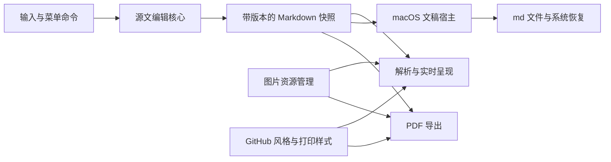

# ReT Markdown 软件需求与架构建议

日期：2026 年 10 月 14 日。状态：首版需求基线；采用方案 A，排版参照本机 Typora 1.14.10 的 GitHub 主题。

ReT Markdown 是面向个人使用的本地 Markdown 编辑器。首版面向 macOS，以单文档窗口提供类似 Typora 的实时编辑体验，支持完整源码视图、数学公式、本地图片及固定版式的 PDF 导出。

产品的核心是直接使用普通 `.md` 文件写作，并保留用户的原始 Markdown 写法。界面保持正文为主，编辑时呈现阅读效果，文件可以继续交给其他 Markdown 工具使用。

本文记录已确认的产品决策、默认规则及其工程细化。性能指标属于交付目标，尚未由产品原型实测；编辑组件的具体选型需通过列出的技术验证。本文交付范围为需求分析、架构基线与验收定义。

## 已确认的产品决策

| 编号 | 事项 | 用户已确认的范围 |
| --- | --- | --- |
| C01 | 使用场景 | 同时考虑课程与技术笔记、技术文档与 README、长文写作，统一使用 Markdown 编写 |
| C02 | 操作系统 | 首版仅支持 macOS，同时考虑未来跨平台扩展 |
| C03 | 默认编辑方式 | Typora 式单区实时编辑，在相关编辑位置按需显示 Markdown 标记 |
| C04 | 源码模式 | 提供可随时切换的完整 Markdown 源码模式，两种模式编辑同一份文档 |
| C05 | 公式 | 首版支持行内公式与块级公式，并支持 PDF 输出 |
| C06 | 窗口与导航 | 每个窗口编辑一份文档，可以打开多个独立窗口；排除多标签页与侧边栏 |
| C07 | 保存机制 | 参考 Typora 的 macOS 文稿机制，包括系统自动保存、手动保存、草稿与文稿版本恢复 |
| C08 | 图片 | 粘贴和拖入的本地图片复制到文档旁的资源目录，使用相对路径引用 |
| C09 | PDF | 固定版式，一键导出；A4 纵向、固定页边距、白底 GitHub 风格 |
| C10 | 源文保留 | 不主动统一列表符号、空行或缩进，尽量保留原始写法与未修改区域 |
| C11 | 深浅色 | 编辑界面跟随 macOS 浅色与深色模式，PDF 始终白底 |
| C12 | 文档规模 | 首版主要面向 1 MB 以内的 Markdown 文件；更大文档保留后续优化方向 |
| C13 | 样式扩展 | 首版固定 GitHub 风格，样式与编辑逻辑分离，为未来自定义模板保留扩展能力 |
| C14 | 操作入口 | 正文为主，通过 macOS 菜单、快捷键和右键菜单操作，不提供浮动格式工具条 |
| C15 | 架构基线 | 采用方案 A：原生 macOS 文稿外壳与 Markdown 源文编辑核心；优先验证 CodeMirror 6 |
| C16 | 表格交互 | 直接编辑渲染后的单元格，支持 Tab 导航及右键增删行列，后台局部更新 Markdown |
| C17 | 文本粘贴 | 默认粘贴纯文本，不自动将网页或 Word 的富文本格式转换为 Markdown |
| C18 | 图片联网 | 首版仅渲染本地图片；远程图片引用保留并显示占位，联网加载留待后续扩展 |
| C19 | 默认复制 | 正文选区默认复制 Markdown 源文，另提供“复制为纯文本” “复制为带格式文本” |
| C20 | 排版基准 | 直接参考本机当前 Typora GitHub 主题，使用固定的视觉样本、主题声明与哈希作为基准 |
| C21 | 最终默认值评审 | 已接受新文件规则、当前 Mac 验收及启动、打开、输入、内存和包体积目标；排版改按 C20 执行 |

### 范围边界

首版覆盖打开文档、实时写作、源码检查、保存恢复、图片插入及 PDF 导出的完整工作流。

多标签页、文件树侧栏、目录侧栏和浮动格式工具条属于明确排除的界面形式。未来增加导航功能时，仍应遵守这些约束。

跨平台发行、自定义模板管理、用户 CSS 编辑、其他导出格式、Mermaid 和超大文档专项优化列为后续扩展。账号、云端同步、协作、插件市场和 AI 写作不纳入本次范围。

## 用户场景与成功标准

| 场景 | 用户操作 | 成功标准 |
| --- | --- | --- |
| 课程与技术笔记 | 输入中文、列表、代码、公式并粘贴截图 | 输入稳定，公式可编辑，图片落入本地资源目录，重开文件后内容完整 |
| 技术文档 | 打开已有 Markdown 文件，修改局部内容 | 保存后未修改区域保持原始写法，其他工具仍能读取文件 |
| 长文写作 | 连续输入、查找替换、切换源码检查 | 光标与选区稳定，切换模式不丢内容和撤销历史 |
| 阅读与分享 | 将当前文档导出为 PDF | 页面采用固定白底样式，分页完整，正文与代码可搜索、复制 |
| 意外恢复 | 应用异常结束后重新打开 | 可恢复最近成功保存的文稿或草稿；实际恢复边界由已完成的保存决定 |

## 文档格式与源码保真

### F01 文档的权威内容

Markdown 源文是持久化的权威内容。解析树、HTML、公式图形和屏幕 DOM 都是可重新生成的派生表示。保存不得通过整篇 HTML 转换重新生成 Markdown。

新建文档使用 UTF-8 编码。建议同时支持打开 `.md` 与 `.markdown` 文件，默认新建扩展名为 `.md`。遇到不能可靠解码的输入，应明确说明原因并保留原文件。

### F02 原始写法与局部修改

打开文档后未进行编辑时，保存不应改变文件内容。切换模式、改变系统配色、缩放和 PDF 导出均不构成文档内容修改。

修改某个源文区间时，未参与该操作的区间应保持原样，包括列表符号、强调符号、空行、缩进和代码围栏。修改块类型、拆分或合并段落等结构操作，可以调整实现该操作所必需的局部语法。

首版不提供自动整篇格式化，也不在自动保存时执行格式化。已有文件的 LF／CRLF、UTF-8 BOM 和末尾换行状态应保留；新建文件的默认规则见默认规则与确认状态。

### F03 不支持的内容与中间输入状态

不在首版渲染范围内的 Markdown 扩展、元数据和 HTML 应保留源文，并允许在源码模式编辑。实时视图可按原始文本显示；不得在打开或保存时删除。

输入中的未闭合标记、未完成公式和不完整表格可以作为临时文本存在。编辑器不得为了满足解析规则，阻止用户输入或擅自丢弃字符。

## 编辑体验

### F04 单区实时编辑

窗口包含一个连续的文档编辑区域。用户可以在呈现后的标题、段落、列表和引用中直接输入。光标进入相关语法范围时，显示完成当前编辑所需的 Markdown 标记；离开后恢复相应的呈现效果。

代码块显示代码及语法高亮。图片和公式在非编辑状态显示渲染结果，在编辑状态提供其源文入口。可视化结果与源文的位置必须建立可复核的映射。

表格保持渲染状态，用户直接在单元格中输入。支持 Tab 在单元格之间导航，并通过右键菜单新增或删除行列。反向导航建议使用 Shift+Tab；在表格边界不隐式新增行列。

修改单元格文本时，只更新对应源文范围；新增或删除行列时，调整当前表格内必要的行、分隔符与对齐声明。表格外的源文保持原样，操作可撤销。完整源码模式仍可直接编辑表格源文。

### F05 模式切换

通过“显示”菜单和快捷键切换实时模式与完整源码模式。建议快捷键使用 `⌘/`。

两种模式共享同一文档、修改状态和撤销历史。切换前后的源文应完全相同；光标与选区映射到相同的源文位置，滚动位置尽量保留。

### F06 输入与编辑命令

支持中文输入法、英文输入、系统剪贴板、选区、方向键、Home／End 对应的 macOS 导航操作，以及撤销和重做。中文组词期间，实时渲染不得打断候选文字或使光标跳动。

常用格式命令直接作用于源文选区，包括标题、加粗、斜体、行内代码、链接、引用、列表和代码块。菜单应显示已绑定的快捷键。

在已有列表中按回车，沿用该列表的符号与缩进；空列表项的回车行为可退出列表。用户明确改变列表层级时，只调整相关项及必要的子项。

正文选区默认复制对应的 Markdown 源文，另提供“复制为纯文本”和“复制为带格式文本”。实时模式复制完整格式元素时保留其原始语法标记，例如完整的 `**重点**` 片段复制后仍为 `**重点**`；源码模式直接复制所选源文。复制为带格式文本时向剪贴板提供所选内容的 HTML 富文本表示及纯文本回退，采用同一套 Markdown 语法与 GitHub 排版；公式和本地图片尽力保留可见呈现，不为复制加载远程资源。复制不改变文档内容或修改状态。

默认文本粘贴读取剪贴板的纯文本表示并插入，不自动将网页或 Word 的富文本格式转换为 Markdown；已经是 Markdown 的纯文本按原文插入。仅含图片的剪贴板按 F12 的图片插入规则处理。

### F07 查找与替换

提供当前文档内的查找、上一个／下一个、单次替换和全部替换。查找面板按需出现并可关闭，不占用侧边栏。

查找范围以完整源文为准，包含实时模式下隐藏的语法。定位隐藏范围时，应展开必要的源文。一次“全部替换”应可作为一个操作撤销。

### F08 语法范围

| 内容 | 首版要求 |
| --- | --- |
| 段落与标题 | 普通段落、一级至六级标题 |
| 行内格式 | 加粗、斜体、删除线、行内代码 |
| 结构 | 引用、分隔线、有序与无序列表、嵌套列表、任务列表 |
| 链接 | 行内链接、引用式链接与图片引用；打开外部链接使用系统浏览器 |
| 代码 | 围栏代码块和常见语言的高亮；未知语言作为普通代码呈现 |
| 表格 | GFM 表格及列对齐 |
| 数学公式 | `$…$` 行内公式与 `$$…$$` 块级公式 |
| 其他内容 | 原始内容保留；没有对应渲染能力时显示源文 |

建议以 CommonMark 为基础，加上表格、任务列表、删除线等选定的 GFM 扩展及公式扩展。编辑与导出共享同一套语法定义。脚注、自动目录、GitHub Alerts、Mermaid 和可执行 HTML 暂不作为首版渲染验收项。

公式支持常用 LaTeX 数学表达，包括分式、上下标、根式、矩阵及对齐环境。公式无法渲染时保留表达式，并在该位置显示可理解的错误反馈。

## 文件与文稿生命周期

### F09 窗口和文件操作

支持新建、打开、保存、另存或存储副本、关闭窗口，以及通过 Finder 打开 Markdown 文件。每个窗口只包含一份文档，多个文档使用独立窗口。

建议同一路径的文档被再次打开时，激活已存在的窗口，避免两个窗口独立修改同一个文件。所有打开方式遵守同一规则。

### F10 系统保存与恢复

采用 macOS 文稿机制，接入系统调度的自动保存、`⌘S`、未命名草稿恢复、文稿版本与窗口恢复。关闭时是否询问、退出后是否恢复窗口，遵守适用的系统设置。

不将自动保存定义为固定一秒或固定五分钟。系统触发保存时，必须取得最近已提交的源文版本；旧的异步保存结果不得覆盖较新的文档版本。

未命名文档在用户首次正式保存时选择文件名和位置。自动保存草稿不应反复弹出保存面板。草稿恢复应同时恢复文档引用的暂存图片。

### F11 写入失败与外部修改

保存失败时保留内存中的最新内容、修改状态和可恢复草稿，并提供重试或另存入口。只有成功完成写入后，才能将相应版本标记为已保存。

检测到外部程序修改文件时：本地没有未保存修改则可加载外部版本；存在未保存修改则提示冲突，允许保留本地副本、加载外部版本或取消当前处理。不得静默覆盖任意一方。

相同文件的并发自动保存应有顺序保证。具体使用系统文件协调还是额外的版本检查，由架构方案确定。

## 本地图片与资源

### F12 图片插入

支持粘贴剪贴板图片、拖入本地图片，以及通过文件选择器插入图片。首版建议支持 PNG、JPEG、GIF 和静态 SVG；SVG 中的脚本不执行。

对有保存位置的文档，将新插入图片复制到文档旁的 `<文档名>.assets/` 目录，并生成相对路径引用。例如 `笔记.md` 对应 `笔记.assets/`。

图片命名避免覆盖已有文件。原始图片保持不变，文件名中的中文、空格和特殊字符应能被正常引用。打开已有文档时，继续解析其现有相对路径，而不批量迁移已有图片。

### F13 暂存与迁移

未命名文档的图片进入该草稿的独立暂存目录。首次保存时，先成功建立目标资源，再写入引用它们的 Markdown；失败时保留草稿和图片以便重试。

另存到新位置时，建议复制本应用管理的图片到新文档的资源目录，并仅调整对应图片引用；原文档与原资源不变。用户自己管理的其他引用保留原始写法。若新位置导致这些相对路径无法解析，应在另存前列出受影响引用，允许取消；只有用户明确接受保留这些引用时，才继续另存。

资源目录按首次创建时的文档名命名。之后仅重命名 Markdown 文件时，不强制重命名资源目录，以免改写原引用。跨目录移动时，需要将文档和它引用的资源一并移动。

### F14 图片删除与恢复

删除 Markdown 图片引用、撤销插入或关闭窗口，不自动删除资源目录中的图片。这样可避免破坏撤销历史、文稿旧版本或其他文件的引用。资源清理留待后续显式功能。

本地图片缺失时，显示可定位的占位与路径，允许用户修复引用。远程图片保留原 URL 并显示占位，不自动请求远程资源，也不转换为本地图片。

## PDF 导出

### F15 导出入口与内容快照

提供“文件 → 导出为 PDF”。用户选择输出位置后生成文件，不显示纸张和页边距配置界面。覆盖已有文件时使用标准确认行为。

导出使用当前文档最近已提交的源文快照，包含尚未正式保存的修改。导出过程不改变当前文档路径、内容或修改状态。实时模式与源码模式的相同内容应产生相同排版结果。

### F16 固定版式

使用 A4 纵向、白底、GitHub 风格，四边 20 mm 页边距并自动分页。不添加封面、目录、页眉、页脚或页码。打印排版参考视觉基准中的 13 px 根字号；屏幕容器内边距不叠加为额外纸张边距。

正文和代码使用真正的 PDF 文本，可搜索和复制；不以整页截图替代。中文、图片和公式应正确呈现，公式采用可缩放的清晰图形；公式字符的文本提取不作为首版保证。

分页避免标题单独留在页末。能放入一页的图片、公式和短代码块应尽量保持完整；超过一页的代码块与表格允许分页。长代码行可在 PDF 中换行，但不改写源文。

超宽内容应合理换行或缩放；确实不能完整排版时，明确定位问题内容，而不是静默裁切。本地资源缺失或公式渲染失败时，阻止导出并定位错误，修复后重试。对于首版明确不加载的远程图片，在 PDF 中保留标明原 URL 的占位，与缺失的本地资源区分处理。

### F17 导出错误处理

等待图片、字体和公式完成加载后再输出。失败或取消时，不留下被误认为成功结果的不完整文件，也不替换已有的有效 PDF。

编辑器配色不影响导出配色。纸张尺寸、打印页边距与页面样式集中定义，后续其他导出格式通过独立接口扩展。

## 页面与样式

### F18 页面布局

默认窗口以必要的原生标题栏和正文区域组成。正文居中，具有适合连续阅读的最大宽度，并适应窗口缩放。操作通过菜单、快捷键及右键菜单进行。

查找、错误与保存状态按需呈现；不设置文件树、目录侧栏、标签栏或浮动格式工具条。建议首版不增加常驻字数栏、焦点模式或打字机模式。

### F19 GitHub 风格与系统配色

排版直接参考本机 Typora 1.14.10（7786）的 `Github` 主题，以 [视觉基准](../references/typora-github-visual-baseline.md) 和 [排版样本](../references/typora-github-sample.md) 验收。主题 CSS 快照与哈希固定本次观察版本，后续 Typora 升级不自动改变本项目基准。

正文以 16 CSS px、1.6 倍行高和 Open Sans 优先的字体栈为基准，中文使用系统字体回退，代码使用等宽字体。阅读容器居中，默认最大宽度 860 px、内边距 30 px、底部留白 100 px；视口达到 1400／1800 CSS px 时，最大宽度分别为 1024／1200 px。容器宽度与净文字宽度须结合盒模型区分。

标题层级、一级与二级标题边线、段落间距、列表缩进、引用、代码及表格遵循视觉基准。浅色模式按当前主题对照；深色模式保留同一套排版层级，适配深色配色。字体资源离线提供，不能引入主题文件中用于导出的远程字体加载行为。

本轮已通过 Computer-Use 查看真实样本，并核对本地主题文件。字号、间距和断点是 CSS 声明，最终视觉需在相同逻辑视口与 100% 编辑缩放下对照；当前未将运行时计算样式或实际 Typora PDF 输出作为已测量结果。

### F20 样式扩展边界

将排版规则、浅色配色、深色配色和打印规则分别维护。主题变化不得改变 Markdown 源文和编辑命令行为。

首版不提供模板切换、CSS 编辑器或用户 CSS 文件入口。后续模板通过独立的样式载入接口扩展，不要求重写编辑核心。

## 默认规则与确认状态

以下列出已确认的默认规则及满足产品范围所需的工程细化。标为“工程细化”的条目约束边界行为，不增加新的产品功能。

| 编号 | 事项 | 默认规则与状态 |
| --- | --- | --- |
| D01 | 平台验收 | 已确认：首先在当前 Apple Silicon Mac 验收；当前环境为 macOS 27.0.1、arm64。其他系统版本或 Intel 不属于首版实测覆盖承诺 |
| D02 | 新建文件 | 已确认：UTF-8、无 BOM、LF；默认不自动补末尾换行，已有文件遵循 F02 |
| D03 | 表格编辑 | 已确认：直接编辑渲染后的单元格，支持 Tab 导航和右键增删行列，见 C16 |
| D04 | 剪贴板 | 已确认：默认粘贴纯文本，默认复制 Markdown 源文，另提供复制为纯文本/带格式文本，见 C17、C19 |
| D05 | 网络 | 已确认：仅渲染本地图片、远程引用显示占位；核心工作流离线可用，PDF 保留带 URL 占位 |
| D06 | PDF 细节 | 四边 20 mm 页边距，不添加页码、页眉、页脚、封面和自动目录；使用当前 GitHub 主题打印排版基准 |
| D07 | 字体与阅读宽度 | 已确认：直接遵循当前 Typora GitHub 视觉基准及 F19，不使用此前另拟的固定阅读宽度 |
| D08 | 额外写作工具 | 工程范围细化：首版不加入字数统计、拼写检查配置、焦点模式和打字机模式 |
| D09 | 超范围文档 | 工程细化：不把 1 MB 设为人工拒绝打开的上限；更大文件尽力处理，可中止加载，必要时保留源码编辑入口 |
| D10 | 图片随另存迁移 | 工程细化：复制应用管理的资源并局部调整引用；不做任意外部资源的自动打包，失效引用按 F13 提示 |

## 非功能需求与性能目标

### 必须满足的质量要求

| 编号 | 要求 | 验收方式 |
| --- | --- | --- |
| N01 | 数据完整 | 输入、模式切换、保存与导出不丢字符，失败后保留可恢复内容 |
| N02 | 源码保真 | 无编辑保存字节一致；局部修改不改写无关源文 |
| N03 | 中文输入稳定 | 拼音组词、候选选择、连续输入与撤销没有重复、丢字或光标跳转 |
| N04 | 本地运行 | 断网状态完成新建、编辑、公式渲染、本地图片插入、保存与 PDF 导出 |
| N05 | 轻量化 | 首版主要服务 1 MB 以内文档；性能与资源占用必须实测，并记录主应用和专属 WebContent 进程 |
| N06 | 界面可操作 | 核心操作可由键盘完成；系统配色切换不重置编辑状态，正文可缩放 |
| N07 | 可扩展 | 平台服务、编辑核心、样式和导出职责分离，未来扩展无需改变 Markdown 文件格式 |

### 量化验收目标

启动、打开、普通输入、内存和包体积目标已经确认。中文输入提交与 PDF 导出时限作为补充工程目标单列。所有数值仍需产品原型实测；调整已确认目标需要记录原因并重新评审，不能以降低 N01 至 N04 的正确性要求来达成速度指标。

在当前 Mac、Release 构建、无调试器和其他重负载的条件下，各时间指标重复 20 次并记录 P95。输入延迟从输入提交开始，到对应文字首次可见结束。

定义两类夹具：常规夹具为约 256 KiB 源文，含 20 个代码块、20 个公式及 10 张本地图片，每张图片不超过 2048 × 1536 像素；边界夹具为约 1 MiB 的文本、列表和代码混合文档。PDF 夹具为排版后约 20 页的中文、代码、公式和本地图片混合文档。

| 项目 | 目标 | 状态 |
| --- | --- | --- |
| 新启动应用至空白文档可输入 | P95 不超过 3 秒 | 已确认 |
| 已运行应用打开 1 MiB 边界夹具至首屏可编辑 | P95 不超过 2 秒 | 已确认 |
| 常规夹具普通输入的可见延迟 | P95 不超过 50 ms | 已确认 |
| 中文输入候选提交至文字可见 | P95 不超过 100 ms | 补充工程目标 |
| 导出约 20 页 PDF 夹具 | P95 不超过 15 秒 | 补充工程目标 |
| 一个常规文档窗口稳定运行后的内存 | 应用与其专属渲染进程的驻留内存总计不超过 512 MiB | 已确认 |
| Release 应用包体积 | 不超过 80 MiB，不计算操作系统已有框架 | 已确认 |

大于 1 MB 的文档先记录加载与输入表现，不以相同速度目标阻断首版交付。解析与渲染接口应允许未来加入增量更新、可视区域渲染和后台计算。

## 工程方案与架构决策

### 方案 A 原生文稿外壳与源文编辑核心

采用 Swift 和 AppKit 的文稿架构管理窗口、文件、系统保存与恢复，以 WKWebView 承载 TypeScript 编辑核心。编辑核心优先验证 CodeMirror 6，并通过装饰与组件呈现 Markdown 的阅读效果。具体编辑组件的最终选择以技术验证结果为依据。

Apple 的文稿架构提供文稿生命周期能力，`autosavesInPlace` 用于声明原位自动保存支持。CodeMirror 提供标记、行、替换和组件等装饰类型。由这些能力推断，这条路线较贴合本项目的系统集成和源文保真要求，但隐藏语法后的输入体验仍需验证。[Apple 文稿架构](https://developer.apple.com/library/archive/documentation/DataManagement/Conceptual/DocBasedAppProgrammingGuideForOSX/Introduction/Introduction.html)、[自动保存声明](https://developer.apple.com/documentation/appkit/nsdocument/autosavesinplace)、[CodeMirror 装饰机制](https://github.com/codemirror/website/blob/main/site/examples/decoration/index.md)

主要成本是自行实现实时呈现、源文位置映射、表格与公式的活动编辑状态，以及原生文稿和编辑事务之间的同步。未来跨平台可复用编辑与渲染核心，但需要新增各平台宿主。

### 方案 B 跨平台宿主与源文编辑核心

使用 Tauri 承载相同的源文编辑核心，并通过平台适配管理文件、菜单和导出。Tauri 使用操作系统 WebView，并具有跨平台宿主结构。[Tauri 架构](https://v2.tauri.app/concept/architecture/)

其优势是未来跨平台宿主更容易共用；针对本项目，原生文稿自动保存、版本恢复和打印仍需设计 macOS 集成，不能把跨平台文件写入等同于完整的系统文稿机制。这是基于需求的工程判断。

### 方案 C 结构化富文本模型与 Markdown 输出

使用 ProseMirror 一类结构化文档模型组织实时编辑，并补充 Markdown 导入输出。ProseMirror 使用自己的树形文档结构。[ProseMirror 文档模型](https://github.com/ProseMirror/website/blob/master/markdown/guide/doc.md)

这条路线更适合围绕结构化块操作组织功能；针对本项目，还需要保存原始词法信息并实施局部输出，才能满足未修改区间保真的要求。原样保留能力不能仅由“支持 Markdown 导入导出”推定。

### 比较与建议

| 维度 | 方案 A | 方案 B | 方案 C |
| --- | --- | --- | --- |
| 系统文稿机制 | 原生宿主直接集成 | 需要 macOS 专项适配 | 取决于选择的宿主 |
| 源文保真 | 源文作为编辑状态，方向契合 | 同样可采用源文状态 | 需额外词法记录和局部输出 |
| 实时编辑成本 | 需要开发装饰与位置映射 | 同样需要开发 | 需开发 Markdown 往返保真 |
| 未来跨平台 | 复用核心，新增宿主 | 宿主与核心均可复用 | 取决于宿主与具体编辑实现 |
| 首版主要风险 | 中文输入、选区与块组件边界 | 上述风险加原生文稿适配 | 原始 Markdown 写法被改写 |

用户已认可方案 A 作为首版架构基线。首版以 macOS 为唯一交付平台，系统文稿机制与源文保真均为明确要求；跨平台通过组件边界保留。方案 B 与 C 作为比较依据保留；若技术验证需要改变已确认的架构方向，应重新评审。

## 推荐的组件边界

以下边界服务于需求和可测试性，不绑定具体文件组织。

| 组件 | 单一职责 | 主要输入与输出 |
| --- | --- | --- |
| 文稿宿主 | 窗口、文件身份、系统保存恢复和文件协调 | 文件 URL、带版本的源文快照、保存结果 |
| 编辑核心 | 源文、选区、编辑事务、撤销历史与模式 | 输入命令、源文区间变化、文档版本 |
| Markdown 解析与呈现 | 源文结构及源文位置映射 | 源文版本、派生语法结构、实时呈现信息 |
| 资源管理 | 图片复制、草稿暂存和保存迁移 | 图片数据、目标文档位置、相对路径 |
| 样式层 | 阅读排版、深浅色与打印样式 | 主题状态、独立样式资源 |
| PDF 导出 | 固定快照的分页排版与输出 | 源文快照、资源解析器、打印样式、PDF 结果 |
| 平台接口 | 隔离剪贴板、文件面板、系统菜单等能力 | 平台无关请求与显式结果 |

源文修改必须携带递增版本。宿主保存某个快照后，只能确认对应版本，不能将仍有新修改的编辑器标为全部已保存。模式与主题切换只影响呈现；PDF 使用固定快照，编辑器可继续维护自己的状态。

## 技术验证与风险处理

| 风险 | 必须回答的问题 | 通过条件 |
| --- | --- | --- |
| 实时呈现与中文输入 | 隐藏标记和替换组件是否打断组词或改变选区 | 中文输入、鼠标选区、跨块删除和撤销无丢字、重复及非预期跳转 |
| 表格单元格编辑 | 渲染组件中的输入、Tab 导航与结构操作能否可靠映射到源文 | 单元格编辑、增删行列与撤销结果正确，表格外源文不变 |
| 源码保真 | 编辑与视图切换是否导致整篇重新输出 | 无编辑保存字节一致，局部编辑的差异仅在目标范围及必要语法范围 |
| 系统自动保存 | 保存快照是否会落后，恢复是否遗漏图片 | 系统触发保存取得已提交版本，恢复内容与资源引用对应 |
| 双模式撤销 | 模式切换是否创建新文档或重置历史 | 模式切换前后可连续撤销，切换本身不成为内容修改 |
| PDF 分页 | WebView 的 PDF 输出能否满足真实分页与文本要求 | A4、边距、中文文本提取、跨页内容和公式检查全部通过 |
| 资源迁移 | 首次保存与另存失败时是否留下失效引用 | 原文和草稿保持可恢复，成功写入的文档引用均可解析 |

这些是候选架构落地前的技术验证问题。不能仅凭框架存在相关 API，就认定已经达到 Typora 的编辑体验或 PDF 排版质量。

如果源文装饰方案在上述验证中不能满足交互要求，应先调整呈现方式或重新评估编辑核心，再更新架构决策；不得通过隐式整篇格式化来绕过保真要求。

## 验收场景与追踪

| 编号 | 验收场景 | 对应需求 |
| --- | --- | --- |
| T01 | 打开含不同列表符号、空行、BOM 与 CRLF 的文件，不编辑直接保存，文件字节一致 | F01、F02、N02 |
| T02 | 只修改一个段落，比较前后文件，其他区域不变化 | F02、N02 |
| T03 | 切换实时／源码模式及系统配色，源文和修改状态不变，光标映射正确 | F05、F19 |
| T04 | 在标题、列表、代码和公式附近连续中文组词、选择候选、删除、撤销 | F04、F06、N03 |
| T05 | 在两种模式之间交替编辑，随后连续撤销，回到最初源文 | F05、F06 |
| T06 | 用三种无序列表符号分别创建列表，回车续项时沿用其符号 | F02、F06 |
| T07 | 打开同一路径两次，激活已有窗口；不同文件使用独立窗口 | F09、C06 |
| T08 | 在系统两种关闭确认设置下检查关闭、退出和重开行为 | F10 |
| T09 | 保存失败及保存期间继续输入，确认最新内容保留、保存版本不倒退 | F10、F11、N01 |
| T10 | 外部编辑文件，分别检查本地无修改和有修改两种情形 | F11 |
| T11 | 新建未命名草稿、粘贴图片、首次保存，检查相对路径及资源迁移 | F12、F13 |
| T12 | 重名图片、含空格和中文的图片路径、另存中的外部引用失效确认、撤销图片插入及文稿版本恢复 | F12、F13、F14 |
| T13 | 在隐藏语法范围内查找替换，一次撤销全部替换操作 | F07 |
| T14 | 用同一源文分别从实时和源码模式导出，确认排版结果一致 | F15 |
| T15 | 检查 PDF 的 A4 尺寸、固定边距、白底、中文与代码文本提取、公式及图片 | F16 |
| T16 | 检查标题位于页末、长代码、跨页表格和超宽公式的处理 | F16、F17 |
| T17 | 导出时修改文档、取消导出或制造输出失败，检查快照一致性和旧 PDF 完整性 | F15、F17 |
| T18 | 断网完成核心工作流，确认公式、字体和高亮资源均可用 | N04、D05 |
| T19 | 完成常规与边界夹具的时间、内存和包体积测量 | C12、N05、性能目标 |
| T20 | 打开未支持的语法、元数据和 HTML，修改其他段落后确认原内容保留 | F03、F08 |
| T21 | 直接编辑表格单元格、Tab 导航、右键增删行列并撤销，检查源文与渲染一致且表格外内容不变 | F02、F04、F05、C16 |
| T22 | 从网页或 Word 粘贴带格式内容，确认只插入其纯文本；粘贴 Markdown 纯文本与剪贴板图片时分别遵循原文插入与图片规则 | F06、F12、C17 |
| T23 | 打开包含远程图片引用的文件，检查占位、原 URL 保留与无自动网络请求；按选定的占位规则离线导出 PDF | F14、F16、N04、C18 |
| T24 | 在实时模式复制完整格式片段，确认原始标记保留；复制为纯文本时输出可见文字；复制为带格式文本时在支持 HTML 的目标中保留格式，并提供纯文本回退；源码模式默认按选区复制；检查三种复制均不改变文档内容或修改状态，且不加载远程资源 | F02、F06、C19 |
| T25 | 使用固定样本在相同逻辑视口与缩放下，对照当前 Typora GitHub 的标题、正文、列表、代码、表格及宽度断点；深色保持同样层级，PDF 使用独立打印基准 | F19、F20、C20 |

## 后续扩展方向

先保证当前数据格式与接口能够承载扩展，再按实际需求安排功能。

| 方向 | 首版保留的边界 | 后续工作 |
| --- | --- | --- |
| 更大文档 | 解析与呈现独立，源文变化使用区间和版本描述 | 增量解析、可视范围渲染、后台公式处理及大图片内存管理 |
| 跨平台 | 编辑核心不直接依赖 AppKit，平台能力通过接口提供 | Windows／Linux 宿主、保存恢复适配及平台交互验收 |
| 自定义样式 | 排版、配色、打印样式独立维护 | 模板包、自定义 CSS、样式校验及导出样式选择 |
| 更多导出 | 导出输入采用固定源文快照和资源解析接口 | HTML、其他格式及各自独立的版式设置 |
| 更多语法 | 解析与呈现规则可扩展，未知内容保留 | Mermaid、脚注、目录及其他按需扩展 |

## 参考依据

Typora 在 macOS 上使用系统调度的自动保存，并接入文稿版本恢复；关闭确认与窗口恢复受系统设置影响。[Typora 自动保存](https://support.typora.io/Auto-Save/)、[Typora 版本恢复](https://support.typora.io/Version-Control/)

本地静态分析显示 Typora 列表解析器记录前缀与缩进，Markdown 输出器优先复用这些记录。这支持“保留原始写法”的设计方向，不构成所有操作均逐字保真的运行证明。[首轮分析报告](../../analysis/typora-1.14.10/REPORT.txt)、[列表解析模块](../../analysis/typora-1.14.10/modules/main/067-18.js)、[Markdown 输出模块](../../analysis/typora-1.14.10/modules/main/004-10.js)

当前 GitHub 主题的实际观察、CSS 声明、样本与来源摘要见 [视觉基准](../references/typora-github-visual-baseline.md)。它固定本次样式版本，并区分真实 UI 观察与尚未执行的宽度、计算样式及 PDF 验证。

候选框架的机制与来源链接放在对应方案中。性能目标与确认状态见量化验收目标；组件划分与补充工程目标属于实现前验证的依据。

## 需求基线与后续交付

用户已确认核心产品决策、方案 A 及最终评审中的其他默认条目，并要求将排版目标直接替换为当前 Typora GitHub 主题。本文据此形成首版需求基线；技术验证、性能测量与实际产品视觉验收属于后续交付工作。

后续实现计划应沿用本文的需求编号、验证问题、视觉基准与验收场景。涉及已确认产品范围、原文保存规则或架构方向的改变，需要更新需求基线。
